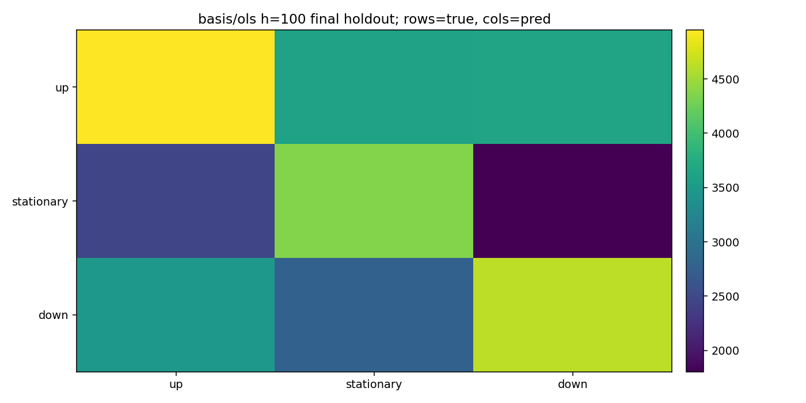
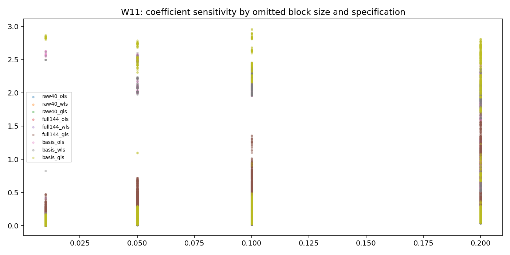
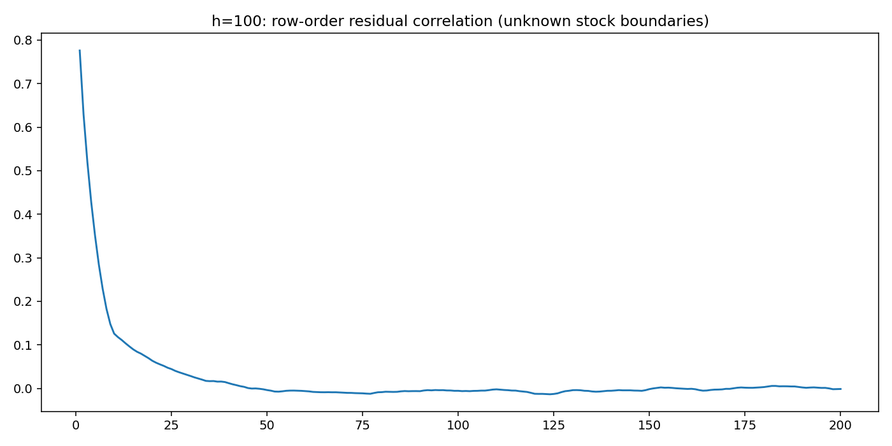

# RT-Project

## Reading the order book with classical regression

A Regression Techniques project on the FI-2010 limit order book benchmark. We apply ordinary least squares (OLS), feasible weighted least squares (WLS), feasible AR(1) generalized least squares (GLS), and regression diagnostics to study price-direction labels, predictor redundancy, and sensitivity to removing blocks of observations.

**Authors:** Raj Lohar (BSD-CC-2414) and Aayush Jha (BSD-CC-2401).

[Read the report](Report.pdf) | [Python implementation](Code/main.py) | [Saved Kaggle results](Result/) | [Download the dataset](https://www.kaggle.com/datasets/alpha000x/fi-2010)

## Repository contents

```text
RT-Project/
  Report.pdf
  README.md
  Code/
    main.py
    requirements.txt
    restore_results.py
  Result/
    Archives/
      analysis-01.zip
      analysis-02.zip
      manifest.json
    NoAuction_Zscore/
      influence_h*.csv.gz
      ... preview graphs ...
```

All 981 original Kaggle result files are provided, including 442 PNG graphs, 161 CSV tables, fitted-model arrays, selected predictions, diagnostic summaries, and execution logs. For storage, most outputs are bundled in two ZIP archives under `Result/Archives/`. Five large `influence_h*.csv` tables are stored as lossless `.csv.gz` files. The three graphs shown below are also directly viewable in the repository.

After downloading the repository, run the restoration command below. It extracts the archives, decompresses the five CSVs, and checks all 981 restored files against their original sizes and SHA-256 checksums. It uses only the Python standard library and does not rerun the experiment.

```bash
python3 Code/restore_results.py
```

Then open `Result/report.html` locally to browse the complete figure gallery and tables. The original outputs retain their original contents and paths after restoration. ZIP and gzip storage copies remain available alongside the restored files.

## Dataset and targets

The downloadable dataset is [alpha000x/fi-2010 on Kaggle](https://www.kaggle.com/datasets/alpha000x/fi-2010). The benchmark provides Auction and NoAuction variants, each with Z-score, MinMax, and decimal-precision normalization. These six views overlap and are analyzed separately rather than pooled as independent observations.

The NoAuction view contains 394,337 observations over ten trading days. Its 144 input features include 40 raw order book variables and 104 supplied engineered features. Each row has up, stationary, or down labels at horizons of 10, 20, 30, 50, and 100 events. Horizons measure events, not seconds. Raw dataset files are not redistributed in this repository.

## Experiment design

- Use three expanding chronological validation windows within days 1 through 9 to select the specification at each horizon.
- Reserve day 10 for final evaluation. Apply a 100-row purge at the train/test boundary; the primary final evaluation uses 31,737 rows.
- Compare raw40, full144, and a limited polynomial-and-interaction basis with OLS, WLS, and GLS.
- Fit three class-indicator responses and take the largest fitted score as the predicted class. These scores are unbounded and are not calibrated probabilities.
- Fit additional scaling and feature/rank selection using training data only. The fitting scope of normalization already supplied by the benchmark is not verified.
- Examine collinearity, residual dependence, influence, and repeated contiguous-block deletion sensitivity.

The completed run took approximately 7 hours and 50 minutes on two Tesla T4 GPUs and performed 40,064 block-deletion refits. CPU and GPU use is recorded in the saved hardware and resource logs. Full device-memory occupancy is not claimed.

## Main results

The primary view is NoAuction_Zscore. Models below were selected on validation before evaluating the final day.

| Horizon (events) | Selected specification | Heldout macro-F1 | Heldout accuracy |
|---|---|---:|---:|
| 10 | full144 WLS | 28.57% | 66.98% |
| 20 | full144 WLS | 36.84% | 59.06% |
| 30 | full144 OLS | 36.30% | 53.05% |
| 50 | basis WLS | 41.17% | 46.52% |
| 100 | basis OLS | 44.06% | 44.00% |

At 100 events, the selected basis OLS model reaches 44.06% macro-F1. The training-majority baseline reaches 18.51%; an independent random-prediction reference using training class proportions is approximately 33.29%. That random value is an analytical reference calculated after the run, not a separately trained classifier or a significance test.

The 10-event result illustrates why accuracy alone is misleading: 66.98% accuracy accompanies only 28.57% macro-F1, with up/down recalls of approximately 0.73% and 2.09%. Most predictions are stationary.



### Coefficient interpretation is fragile

We find nine constant predictors and 544 predictor pairs with absolute correlation at least 0.95. A correlation-spectrum rule identifies 89 effective directions among 135 nonconstant predictors, while the more permissive pivoted-QR rule retains 136 columns including the intercept. These are different numerical-rank criteria.

Across full144 OLS block deletions that omit 20% of training rows, the median relative coefficient-vector change is 43.06%, while median anchor class disagreement is 5.10%. Coefficients move much more than class decisions. Anchor rows are fixed training observations; this is a sensitivity analysis rather than new holdout performance or a confidence interval.



### Covariance corrections are not automatic improvements

Across 15 matched feature/horizon comparisons in the primary view, WLS changes macro-F1 by a median of +0.052 percentage points relative to OLS. GLS is below OLS in 13 of 15 comparisons, with a median change of -2.22 points. The row-order AR(1) assumption is limited by the absence of reliable instrument boundaries.

At 100 events, the full144 direction regression has lag-1 residual correlation near 0.776. Gaussian IID reference p-values and intervals therefore do not establish valid statistical significance for this dataset.



## Run on Kaggle

1. Attach the [FI-2010 dataset](https://www.kaggle.com/datasets/alpha000x/fi-2010) and enable the available GPU accelerator.
2. Place `main.py` and `requirements.txt` from `Code/` in the working directory.
3. Install requirements, then run the Python file. No command-line arguments are required.

```bash
pip install -r requirements.txt
python3 main.py
```

The defaults in `SETTINGS` are:

```python
'input': '/kaggle/input/datasets/alpha000x/fi-2010/BenchmarkDatasets'
'output': '/kaggle/working/fi2010_results'
'hours': 8.0
```

The program discovers available benchmark files and visible CUDA devices. Required analyses finish even if the target time is exceeded; optional deletion refits stop near the configured budget. The budget does not guarantee an exact runtime. CPU execution is supported but can be substantially slower. To run elsewhere, edit the input and output paths in `SETTINGS`; the dataset must already be present. The program does not download it.

## DeepLOB comparison and limitations

DeepLOB figures and scores in the report come from the published paper by Zhang, Zohren, and Roberts. DeepLOB was not trained or executed in this project. Its reported evaluation protocols differ from our first-nine-days/day-ten split, so the comparison provides literature context rather than a controlled head-to-head experiment. The paper's reported F1 should not automatically be treated as identical to our macro-F1.

The project does not demonstrate a profitable trading strategy, a causal relationship, or a new estimator. Labels overlap in time, benchmark views share observations, upstream normalization scope is uncertain, and reliable stock boundaries are unavailable. Further untouched days and dependence-aware evaluation would be needed to support a repeatable predictive edge.

## Sources

- [FI-2010 dataset download](https://www.kaggle.com/datasets/alpha000x/fi-2010).
- Ntakaris et al., *Benchmark Dataset for Mid-Price Forecasting of Limit Order Book Data with Machine Learning Methods*. [arXiv:1705.03233](https://arxiv.org/abs/1705.03233).
- Zhang, Zohren, and Roberts, *DeepLOB: Deep Convolutional Neural Networks for Limit Order Books*, IEEE Transactions on Signal Processing, 67(11), 3001-3012, 2019. [Paper](https://arxiv.org/abs/1808.03668) | [DOI](https://doi.org/10.1109/TSP.2019.2907260).
- Saved project evidence: `Result/run_summary.json`, `Result/NoAuction_Zscore/final_metrics.json`, `frozen_selection.json`, `collinearity.json`, and `deletion_summary.json`.
